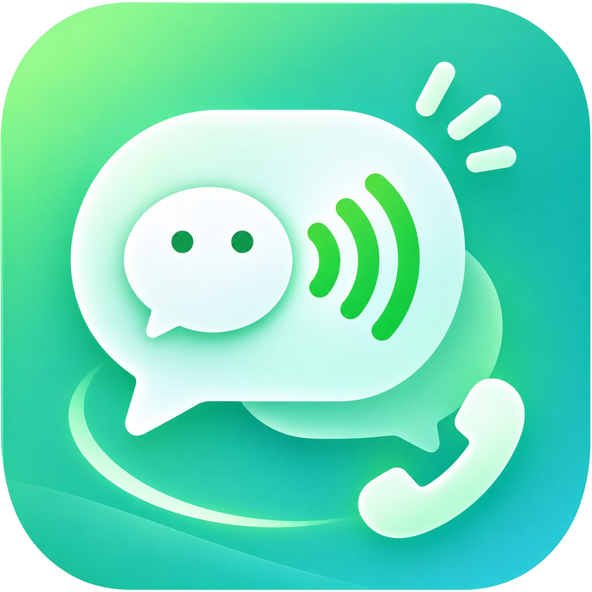
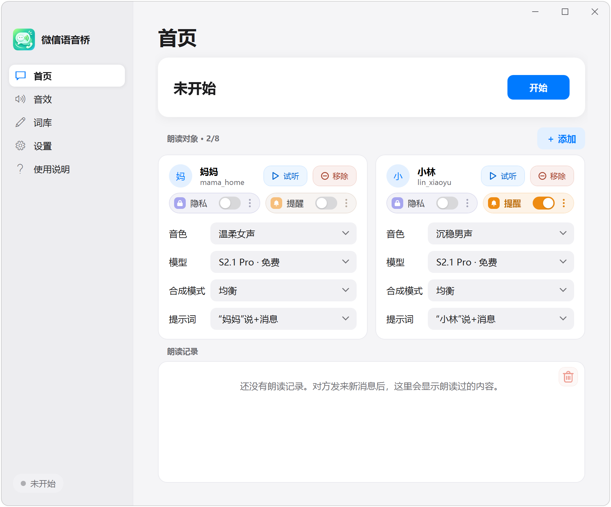
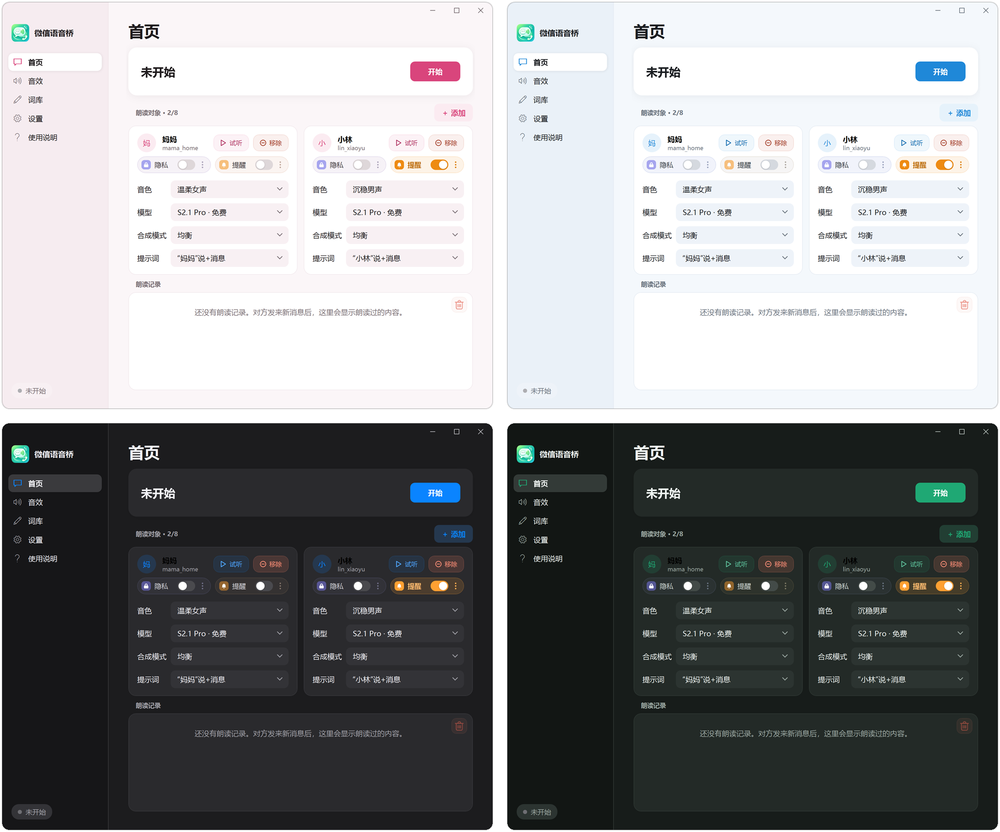

<div align="center">



# 微信语音桥

**让电脑微信的消息，用你熟悉的声音读出来。**

[](#下载)
[](#下载)
[](#下载)

[下载](#下载) · [三步开始](#三步开始) · [使用说明](docs/user-guide.md) · [隐私与安全](#隐私与安全) · [English](#english)

</div>

微信语音桥是一款 Windows 桌面软件。选好联系人，给每个人挑一个声音，他们在电脑微信上发来的新文字消息就会被自动读出来。手和眼睛在忙别的，也不会漏掉要紧的消息。

- **只读，不碰微信**：只读取本机微信数据库的只读副本，只查你选中的联系人。不注入微信、不改微信，也不替你发消息。
- **声音由你来选**：接入 19 种语音服务，包括 13 家主流厂商、2 种通用协议和 4 种在自己电脑上运行的模型。微软 Edge 朗读免费，不用 Key；也可以用克隆的声音。
- **装上就能用**：一个安装包，自带 .NET、Python 和 SQLCipher。按用户安装，不需要管理员权限。

<p align="center"></p>

## 适合这些时候

- 在电脑前写东西、画图、打游戏时，家人和同事的消息不用切窗口也能听到。
- 给每个人配一个声音，一听就知道是谁发来的。
- 看屏幕吃力时，用耳朵代替眼睛。

## 功能

- **多人朗读**：最多 8 人，各用各的声音；几条消息同时到，排队依次读。
- **提示词**：先报名字再读内容，比如“小林说：……”。
- **隐私模式**：身边有人时，只说“微信来消息了”或一句只有你懂的暗语，不读内容。
- **提醒模式**：消息没回，就按你设的间隔再提醒；回复了或点「✓ 已读」就停。
- **词库**：改某个词的读法，比如把缩写读成全称、把表情读成文字。
- **外观**：浅色、深色或跟随系统；主题色有默认、浅绿、浅粉、浅蓝。
- **自动更新**：新版本下载后先核对大小和 SHA-256 再安装；新版本启动失败会自动换回旧版本。

<p align="center"></p>

## 下载

| 文件 | 说明 |
| --- | --- |
| [**安装包** WeChat-Voice-Bridge-V1.8.0-Setup.exe](https://iceland.de5.net/voice-bridge/WeChat-Voice-Bridge-V1.8.0-Setup.exe) | 推荐。中文安装向导，装好后在桌面和开始菜单建快捷方式 |
| [免安装版 WeChat-Voice-Bridge-V1.8.0-win-x64.zip](https://iceland.de5.net/voice-bridge/WeChat-Voice-Bridge-V1.8.0-win-x64.zip) | 完整解压后运行 `WeChatVoiceBridge.exe` |

- **系统**：Windows 10 或 11，64 位。
- **微信**：电脑微信 4.1.11 至 4.2.0.13，其中 4.2.0.13 已实测。不在这个范围内的版本，打开软件时会提示。
- 安装到 `%LOCALAPPDATA%\Programs\微信语音桥`，不弹管理员确认。安装包没有代码签名，Windows 可能提示「未知发布者」。
- 装好以后，软件会自己检查更新。

## 三步开始

1. **打开电脑微信，确认版本**：版本号在微信左下角「≡ → 设置 → 关于微信」里。微信的数据目录软件会自己找到。
2. **添加语音服务和音色**：在「设置 → 语音服务」添加一家，填入它的 API Key，每家都附有获取链接。想先试试，就选「微软 Edge 朗读」，不用 Key。然后到「音效」添加一个音色，试听一句。
3. **添加联系人，开始监听**：在「首页」点「＋ 添加」，选中联系人并给他选一个音色，再点「开始」。左下角显示「正在监听」以后，对方新发来的文字消息就会被读出来。

更多说明见 [使用说明](docs/user-guide.md)，软件左侧的「使用说明」页也是同样的内容。

## 支持的语音服务

| 类别 | 包括 |
| --- | --- |
| 主流厂商，填 Key 就能用 | Fish Audio（免费 · 🌐）、OpenAI（🌐）、ElevenLabs（🌐）、Azure 语音服务（免费）、Google Gemini（免费 · 🌐）、火山引擎 · 豆包语音、阿里云百炼、MiniMax（国内）、MiniMax（国际）、硅基流动 SiliconFlow、阶跃星辰、智谱 GLM-TTS、微软 Edge 朗读（免费，不用 Key） |
| 通用协议，接其他厂商或网关 | OpenAI 兼容接口、自定义 HTTP 接口 |
| 自建模型，在自己电脑上运行 | GPT-SoVITS、fish-speech / OpenAudio、Kokoro-FastAPI、LocalAI |

🌐 表示在中国大陆需要海外网络；「免费」表示有免费额度，或者完全免费。各家的配置方法见 [语音服务说明](docs/providers.md)。

## 工作原理

```text
电脑微信的本机数据库 ──只读副本──▶ 读取进程（Python）──新消息──▶ 微信语音桥（WPF）
                                                                  │
                                         你选的语音服务或本机模型 ◀─┘ ──声音──▶ 扬声器
```

- 点「开始」后，读取进程从正在运行的电脑微信里取得本机数据库的密钥（只读内存），把加密的数据库复制成临时副本，只查询你选中的联系人新发来的文字。点「结束」或退出时，副本会被删掉。
- 主程序把文字交给你选的语音服务合成，再用 Windows 的音频设备播放。
- 读取微信内存的代码只在一个经过审计的文件里（`worker/audited_wechat_keys.py`）。`scripts/Verify-Source.ps1` 会检查整个仓库，不允许出现写内存、注入或钩子调用。

## 隐私与安全

- 聊天内容只在这台电脑上读取。软件不收集、不上传你的聊天，也没有任何统计。
- 软件只在三种情况下联网：把要读的文字发给你选的语音服务（用自建模型则不出本机）；从微信官方的头像服务器下载联系人头像；检查更新。
- API Key 用你的 Windows 账户加密保存在本机，不写进配置文件。安装包里不带任何服务、密钥或音色，打包脚本会拒绝含有设置、密钥或数据库的安装包。
- 请只添加同意被朗读的联系人；克隆某个人的声音之前，请先取得他本人的同意。

## 从源码构建

需要 Windows x64 和 .NET 8 SDK；开发读取进程还需要 Python 3.12 x64 和 `py` 启动器。在仓库根目录用 PowerShell 运行：

```powershell
.\scripts\New-WorkerVenv.ps1      # 准备读取进程的 Python 环境
.\scripts\Run.ps1 -Development    # 开发模式运行
.\scripts\Test.ps1                # .NET 与 Python 测试
.\scripts\Verify-Source.ps1       # 安全边界检查，提交前必跑
.\scripts\Publish.ps1             # 生成带运行时的发布目录和 ZIP
.\scripts\Build-Installer.ps1     # 生成安装包（需要 Inno Setup 6）
```

| 目录 | 内容 |
| --- | --- |
| `src/VoiceBridge.App` | 界面（WPF） |
| `src/VoiceBridge.Core` | 会话、设置、语音服务目录、更新 |
| `src/VoiceBridge.FishAudio` | 各家语音服务的合成客户端 |
| `src/VoiceBridge.WeChat` | 微信目录识别、读取进程管理 |
| `src/VoiceBridge.Audio` | 音频播放 |
| `worker/` | 读取进程（Python） |
| `tests/` | .NET 与 Python 测试 |
| `scripts/` | 运行、测试、打包脚本 |

更多资料：[语音服务说明](docs/providers.md) · [会话与进程间通信](docs/architecture.md) · [读取组件安全审计](docs/security-review.md)

## 免责声明

- 本项目是个人开源项目，与腾讯公司无关，也没有得到腾讯的授权或认可。「微信」是腾讯公司的商标。
- 本软件只用于在你自己的电脑上读取你自己登录的微信里的消息。使用前请阅读并遵守《微信软件许可及服务协议》和所在地的法律法规，使用风险由你自己承担。
- 微信更新以后，软件可能要等适配了新版本才能继续使用。

## 致谢

读取微信数据库的部分参考了 [wechatauto-replica](https://github.com/fanyuantaier/wechatauto-replica)（Apache-2.0，许可证见 `worker/WECHATAUTO-LICENSE.txt`）和 [wechat4-db-decrypt](https://github.com/fangtimmy/wechat4-db-decrypt)。微软 Edge 朗读通过 [edge-tts](https://github.com/rany2/edge-tts)（LGPL-3.0）接入，音频播放用 [NAudio](https://github.com/naudio/NAudio)，加密数据库由 [SQLCipher](https://www.zetetic.net/sqlcipher/) 打开。

## English

WeChat Voice Bridge is a Windows desktop app that reads new text messages from the contacts you pick in PC WeChat (4.1.11 – 4.2.0.13) aloud, each in a voice you choose. It works with 19 text-to-speech options: 13 cloud vendors, 2 generic protocols, 4 models that run on your own machine, and free Microsoft Edge read-aloud. It reads a read-only copy of the local WeChat database, queries only the contacts you selected, and never injects into or modifies WeChat. The interface is in Chinese.
